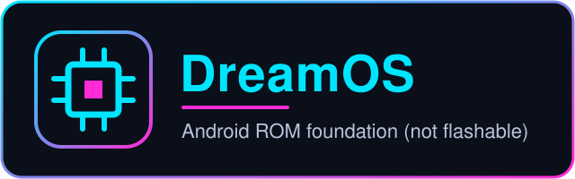

<div align="center">



# DreamOS Victorious

**Source-integration foundation for a customized Android OS (Phase 1, not flashable).**

<p>
  <a href="https://github.com/Victorious93/DreamOS-Victorious/actions/workflows/ci.yml"></a>
  
  
  <a href="https://victorious-framework.pages.dev"></a>
</p>

<p><a href="https://github.com/Victorious93/DreamOS-Victorious/releases">Releases</a> · <a href="https://victorious-framework.pages.dev">Victorious Framework</a></p>

</div>

---

> **Phase 1: Android ROM source-integration foundation. NOT flashable.** Do not flash the ZIP produced by the `bundle` command: it contains source files, not Android partition images or an installer.

A Victorious Framework project for a customized Android operating-system experience. Device-specific ROM builds are the physical target; VMOS Pro / vPhone is evaluated as a separate virtual target.

## Verified implementation status

| Component | Status |
| --- | --- |
| Host-side profile validator | Implemented and unit tested |
| Reproducible source bundle (`zip`) | Implemented and unit tested |
| Bundle manifest / SHA-256 integrity verifier | Implemented and unit tested |
| VMOS Pro ROM zip tools (check, list, diff, overlay + repack) | Implemented, synthetic tests only; import into VMOS Pro is **untested** |
| Read-only ADB property collection script | Implemented, **not tested with a real device** |
| Common AOSP product configuration | Example only, **not yet built with AOSP** |
| Physical ROM image / OTA / recovery / installer | Planned (not implemented) |
| VMOS/vPhone-compatible bootable image | Planned (not implemented; import requirements unknown) |
| Magisk / Xposed integration | Not bundled; root stays external and opt-in |
| Location testing | Configuration only; no service or app implemented |

See [docs/ROADMAP.md](docs/ROADMAP.md) for the phased plan; later phases are marked **Planned**.

## Requirements

- Python 3.10+ for the host tooling, with no third-party Python dependencies.
- Linux is recommended for eventual AOSP/Lineage builds. An Android toolchain and a supported target are **not** provided here.

## Usage

```bash
python3 -m dreamos doctor
bash scripts/test.sh
cp profiles/device-template.json profiles/my-device.json
# Edit my-device.json using VERIFIED values for your chosen device.
python3 -m dreamos validate profiles/my-device.json
python3 -m dreamos bundle profiles/my-device.json --out build/dreamos-source-bundle.zip
python3 -m dreamos verify build/dreamos-source-bundle.zip
```

CLI subcommands: `doctor`, `validate`, `bundle`, `verify`, `env`, `sha256`, `vmos`. The provided device templates intentionally fail validation until placeholders are replaced with verified device data. `bundle` never calls Android build tools, flashes hardware, changes bootloaders, touches SELinux or provides root. The supplied AOSP configuration is meant to be copied into a compatible Android source tree and inherited by an existing, verified device product makefile; see [integration steps](docs/INTEGRATION.md).

To collect properties from an already-connected, authorised test phone (read-only):

```bash
adb devices -l
bash scripts/collect-device-info.sh YOUR_DEVICE_SERIAL
```

Do not publish `ro.build.fingerprint` output if device details should stay private.

## Project layout

```
DreamOS-Victorious/
  dreamos/                    Python source-bundle CLI, validation, verification, VMOS tools
  aosp/vendor/dreamos/        Minimal AOSP product configuration
  profiles/                   Non-functional templates requiring real device data
  scripts/                    Test runner and read-only device-property collector
  tests/                      Offline automated tests
  docs/                       Architecture, integration, security, device gates, roadmap
  .github/workflows/          Offline CI
```

Further reading: [ARCHITECTURE.md](ARCHITECTURE.md) · [BUILD.md](BUILD.md) · [DEVICE_SUPPORT.md](DEVICE_SUPPORT.md) · [SECURITY.md](SECURITY.md) · [TESTING.md](TESTING.md) · [CHANGELOG.md](CHANGELOG.md).

## Development policy

- Keep physical and virtual targets in separate profiles and build pipelines.
- Do not disable SELinux, verified boot, disk encryption or bootloader security to work around compatibility errors.
- Treat Magisk/Xposed as explicitly user-enabled, version- and device-specific optional integrations. Never imply they ship here.
- No arbitrary device flashing or `fastboot flash` command is part of this repository.
- The name and scope were recovered from an earlier DreamOS project conversation; unrecovered original requirements are pending verification (see [provenance](docs/PROVENANCE.md)).

## Install

There is nothing to install or download: no releases are published, and this repository produces no flashable artifact.

---

## Victorious fleet

DreamOS Victorious is part of the [Victorious Framework](https://victorious-framework.pages.dev), a family of Android and PC tools by Don Victor. **Every app works standalone; fleet integrations are optional** and never required.

Related: [droidcommand-AI](https://github.com/Victorious93/droidcommand-AI) (fleet controller), [VictorRecovery](https://github.com/Victorious93/VictorRecovery) (custom recovery), [victorious-flash](https://github.com/Victorious93/victorious-flash) (flashing tool). The full roster lives in [victorious-fleet](https://github.com/Victorious93/victorious-fleet), and live status is in [fleet-manifest](https://github.com/Victorious93/fleet-manifest).

## Contributing

Issues and pull requests are welcome. Keep changes focused, match the existing code style, never commit secrets or release keys, and keep any fleet integration optional so the app still works on its own. Open a PR against the default branch and wait for CI to pass.

## License

Copyright 2026 Victorious Framework. Licensed under the Apache License 2.0; see [LICENSE](LICENSE).
